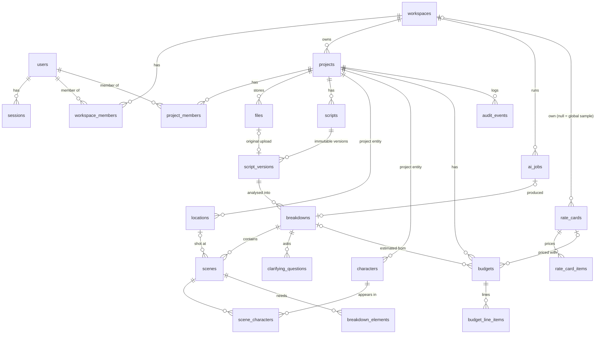
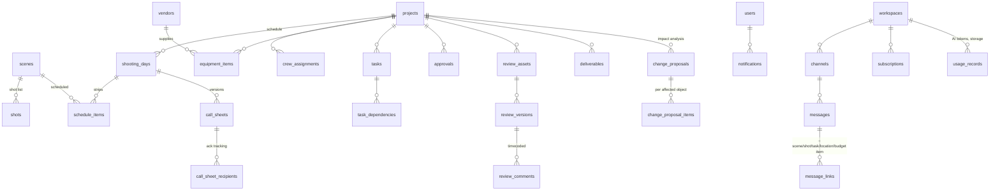

# Database schema

PostgreSQL 16 with Drizzle ORM. The source of truth is `packages/database/src/schema/index.ts`, and migrations live in `packages/database/migrations/`.

## Implemented (migration `0000_init`)

| Table | Notes |
|---|---|
| `users` | Unique index on `lower(email)`. `is_demo` flags seed data |
| `sessions` | `id` = SHA-256 of the token. Cascade on user delete |
| `workspaces` | `ai_external_processing_enabled`, `ai_consent_at` and `ai_consent_by` record the owner's opt-in. `plan_key` is reserved for entitlements |
| `workspace_members` | PK (workspace, user). `role` ∈ owner/admin/member/guest |
| `projects` | `enabled_phases` jsonb lets projects skip stages. Soft delete via `deleted_at` |
| `project_members` | `role` = production role. `overrides` = per-section access |
| `files` | Private storage key, sha256, size, uploader |
| `scripts`, `script_versions` | Versions are never updated. Unique (script, version) |
| `ai_jobs` | Status machine queued→running→succeeded/failed. Stores provider, model, external flag, tokens and validated output. Unique (workspace, idempotency_key) |
| `breakdowns` | Status draft/in_review/confirmed/superseded. `provider_label` is shown in the UI |
| `scenes` | Provenance (`origin`, `confidence`, `confirmation`, `source_ref`), estimate *ranges*, risks, assumptions, `version` for optimistic locking |
| `characters`, `locations` | Unique per project on `normalized_name`, so one entity links across scenes and breakdowns |
| `breakdown_elements` | Category enum, quantity, provenance, source line |
| `clarifying_questions` | At most 5 per breakdown, with answers |
| `rate_cards`, `rate_card_items` | `is_sample` marks placeholder rates |
| `budgets`, `budget_line_items` | Estimated / quoted / approved / committed / actual, `basis`, `rate_key`, `version` |
| `audit_events` | Actor, action, entity, jsonb data (before-values) |

Indexes cover every foreign key used in lookups: project, breakdown+sort, scene, user memberships, and the audit log by project+time.

## Planned (later phases)

`change_proposals` is the heart of the change-impact feature (PRD §10.1/§11). A change such as removing a scene or swapping a location creates a proposal. It lists the affected objects (schedule items, call sheets, budget lines, crew, equipment) and their proposed updates, and nothing applies until someone approves. Committed costs and confirmed bookings are flagged and never touched automatically.

## Retention

- Soft delete for workspaces and projects. Hard delete happens through a future retention job (default 30 days), with an audit record.
- Script versions and AI outputs are kept for the life of the project, for traceability.
- Backups: the managed Postgres provider's PITR (≥ 7 days) plus nightly logical dumps. Restore drills are listed in NEXT_STEPS.
