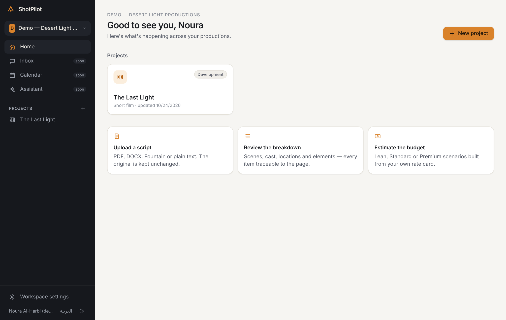
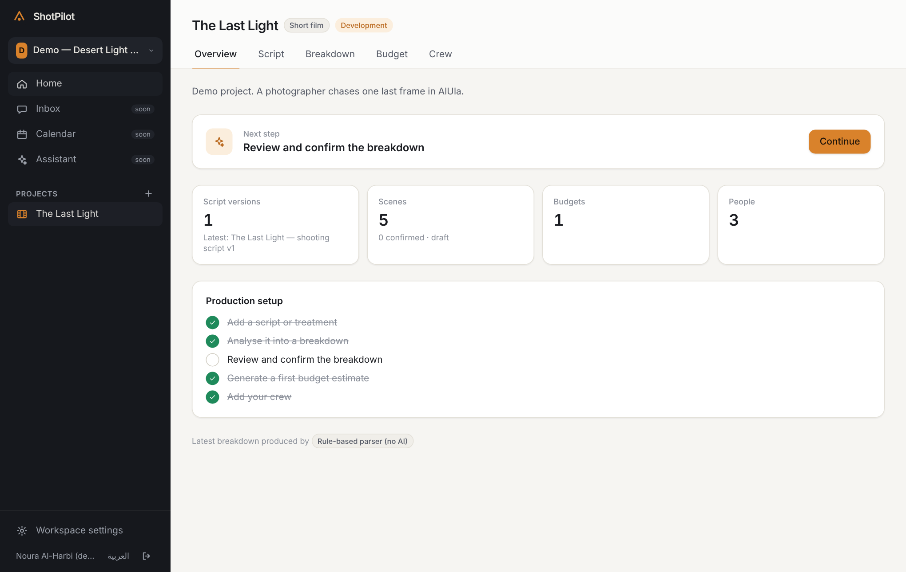
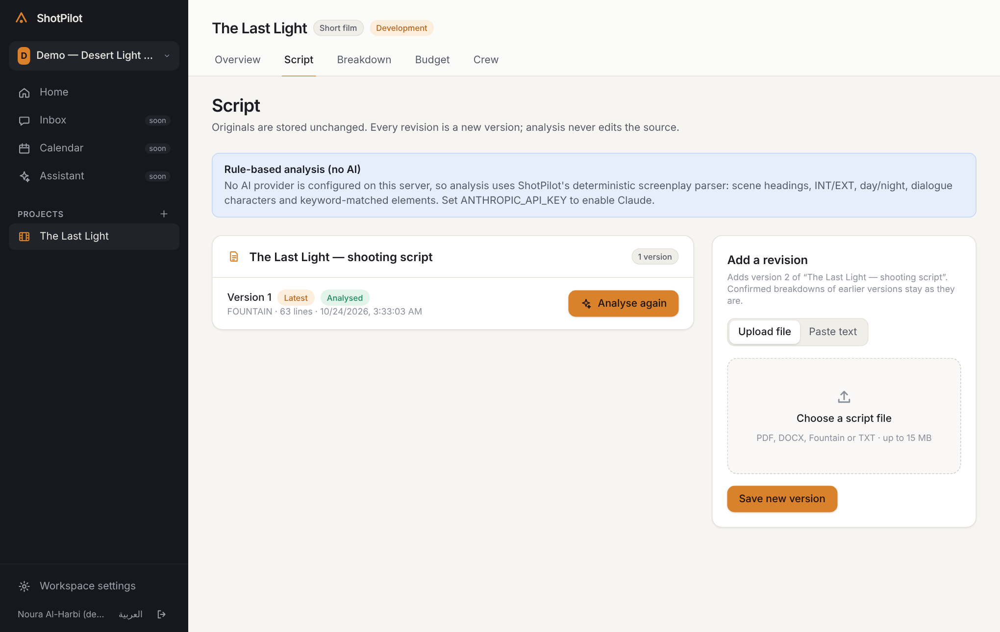
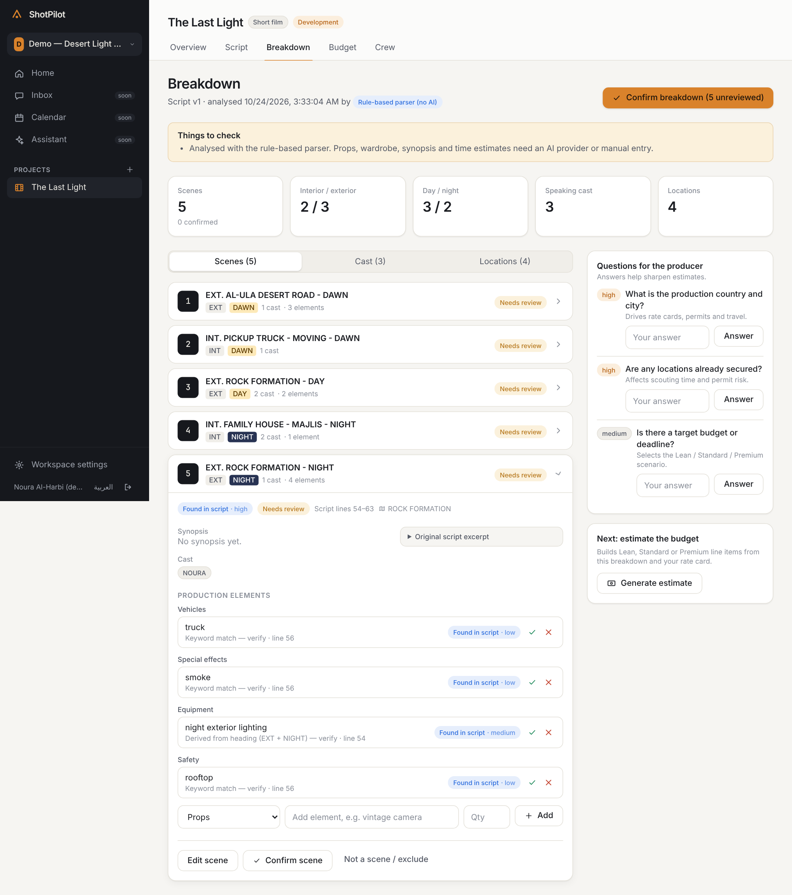
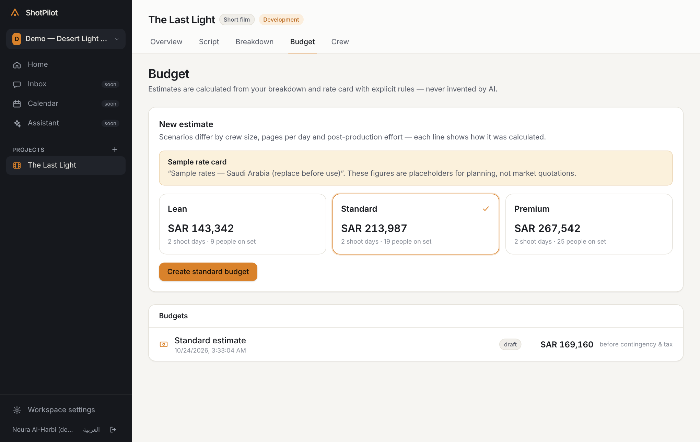
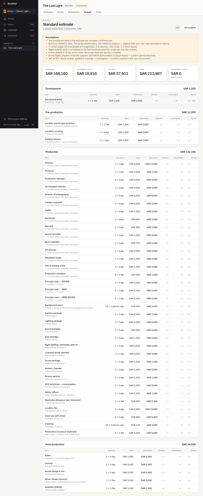
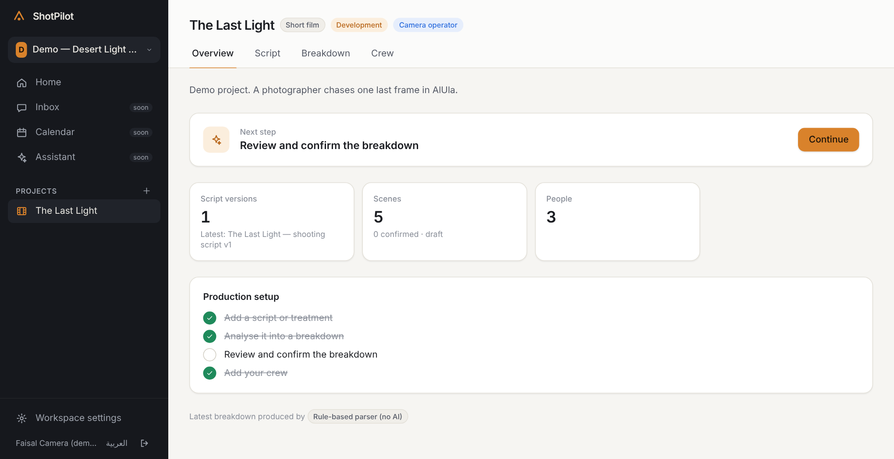
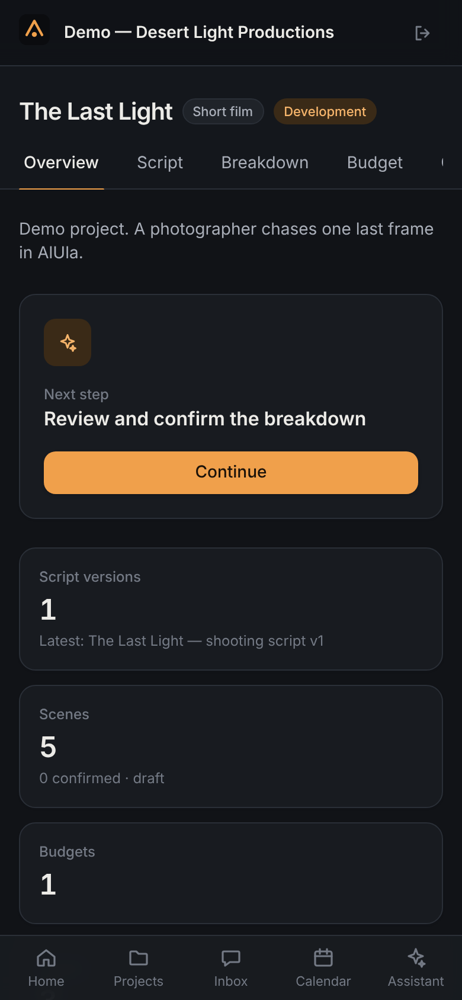

# ShotPilot

**From the first idea to the final frame. One intelligent production workspace.**

## See it (screenshots of the real running app)

> These are real screenshots of the working app with demo data, not mock-ups. GitHub stores the code; the site itself needs a server to run (see "Run it" below).

**1. Your workspace** — all productions in one place.


**2. A project** — shows the next step and what's done.


**3. Script upload** — PDF, Word, Fountain or text. The original is never changed.


**4. Breakdown review** — scenes, cast, locations and props pulled from the script. Every item shows where it came from and needs your confirmation.


**5. Budget scenarios** — Lean, Standard and Premium, calculated from rules and rate cards (never guessed by AI). The sample prices are placeholders.


**6. Editable budget** — every line explains how it was calculated.


**7. Crew and roles** — each role sees only what it should.


**8. What a camera operator sees** — no Budget tab, and the budget page is blocked even by direct link.


**9. On a phone, dark mode**


Also built and tested but not yet shown in the interface: shooting-day scheduling and versioned call sheets with share links.

## Try it in the browser
A working, clickable version lives in `apps/preview` (rebuild with `pnpm preview:build`). It runs entirely in one web page using the real parser, budget, scheduling and permission code. It has no accounts or shared database, and data stays in your browser.

## Run it
The easy way is to ask Claude Code to start it for you, or follow [SETUP_LOCAL.md](SETUP_LOCAL.md). It needs a computer with Node.js and PostgreSQL; GitHub itself cannot run it.

---
ShotPilot is a production operating system for filmmakers, production companies and agencies. You upload a script, and ShotPilot turns it into a connected production plan: breakdown, budget, schedule, crew, call sheets and delivery. Every item traces back to its source. AI suggestions are labelled, and nothing official changes without a person's approval.

> Status: **early development (Phase 1–2 vertical slice).** See [PROJECT_STATUS.md](PROJECT_STATUS.md).

## What works today

- Accounts, sessions and workspaces, plus projects with configurable lifecycle phases
- Server-side role-based access for 20 production roles, with per-member overrides
- Script upload (PDF, DOCX, Fountain, TXT) or pasted text, with immutable versions
- Script analysis through a provider-independent layer:
  - **Claude** (Anthropic) with structured outputs, once an API key is set *and* the workspace owner opts in
  - A **rule-based parser** (clearly labelled "no AI") when no key is configured
- Breakdown review: scenes, cast, locations and elements, each with provenance, confidence and source lines. You can confirm, reject or edit any item, and edit conflicts are detected.
- Deterministic Lean / Standard / Premium estimates, with editable budgets built from a configurable rate card (a **sample** Saudi Arabia / SAR card is included)
- Crew list with role-based visibility
- JSON API (`/api/v1`) with bearer tokens for the native iOS app (the SwiftUI scaffold is in `apps/ios`)

## Quick start

```bash
git clone <PRIVATE_REPOSITORY_URL>
cd shotpilot
pnpm install
cp .env.example .env          # then edit if needed
pnpm db:setup                 # creates shotpilot_dev + shotpilot_test, runs migrations
pnpm db:seed                  # optional demo data
pnpm dev                      # http://localhost:3000
```

Full instructions, including Postgres installation on macOS, are in [SETUP_LOCAL.md](SETUP_LOCAL.md).

## Repository layout

```
apps/web               Next.js 16 web app (UI, server actions, /api/v1 routes)
apps/ios               SwiftUI app scaffold (not yet compiled)
packages/shared        Domain types, zod schemas, permissions, i18n (en/ar)
packages/database      Drizzle schema, migrations, DB client, sample rate card
packages/ai            Provider abstraction (Claude, rule-based), screenplay parser, document extraction
packages/api           Services: auth, authorization, projects, scripts, analysis, breakdown, estimation, budgets
packages/design-tokens CSS design tokens shared by web and iOS
tests/                 Test setup and fixtures
scripts/               DB setup and demo seed
```

## Documentation

| Doc | Purpose |
|---|---|
| [PROJECT_STATUS.md](PROJECT_STATUS.md) | What's done, what works, known issues, latest validated commit |
| [NEXT_STEPS.md](NEXT_STEPS.md) | The exact next tasks |
| [PRODUCT_REQUIREMENTS.md](PRODUCT_REQUIREMENTS.md) | Product scope, users, journeys, differentiation |
| [ARCHITECTURE.md](ARCHITECTURE.md) | System design, security model, AI design |
| [DATABASE_SCHEMA.md](DATABASE_SCHEMA.md) | ERD (current and planned) |
| [DESIGN_SYSTEM.md](DESIGN_SYSTEM.md) | Visual language, tokens, components, RTL |
| [IMPLEMENTATION_PLAN.md](IMPLEMENTATION_PLAN.md) | Phased roadmap and risks |
| [DECISIONS.md](DECISIONS.md) | Architecture decision log |
| [CHANGELOG.md](CHANGELOG.md) | Change history |
| [SETUP_LOCAL.md](SETUP_LOCAL.md) | Local setup on a Mac |

## Commands

| Command | What it does |
|---|---|
| `pnpm dev` | Run the web app in development |
| `pnpm typecheck` | Type-check every package |
| `pnpm test` | Unit + integration tests (real Postgres, wipes `*_test` DB) |
| `pnpm build` | Production build of the web app |
| `pnpm test:e2e` | Playwright end-to-end tests (desktop + mobile) against a production build |
| `pnpm db:generate` | Generate a migration after a schema change |
| `pnpm db:migrate` | Apply migrations |
| `pnpm db:seed` | Insert clearly-marked demo data |
